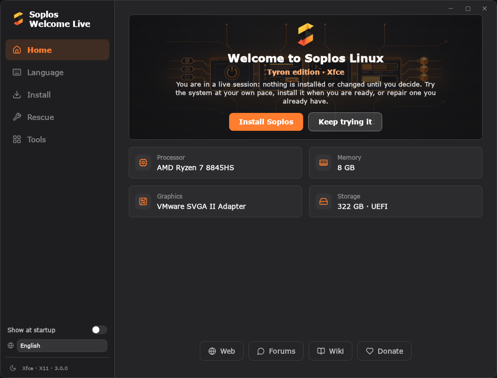
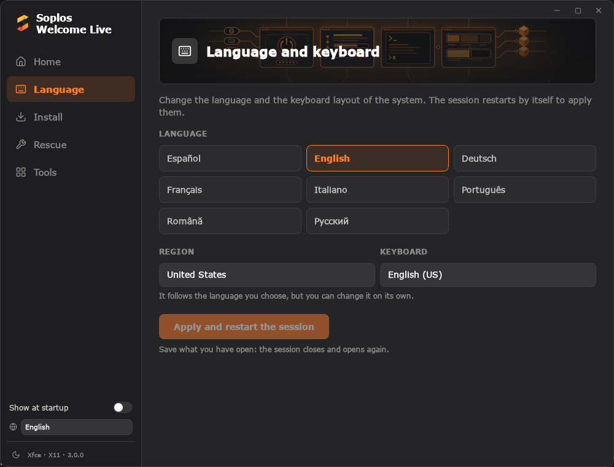
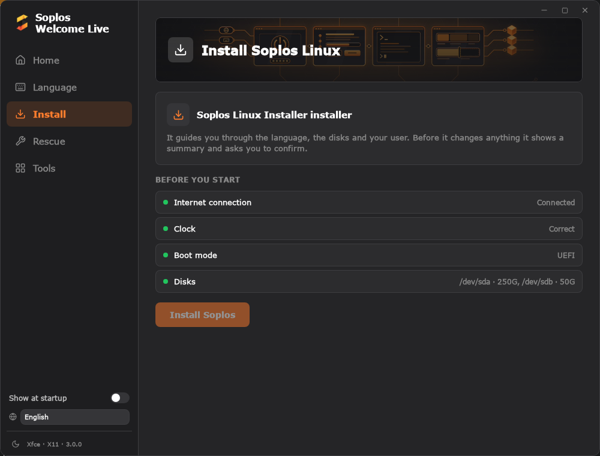
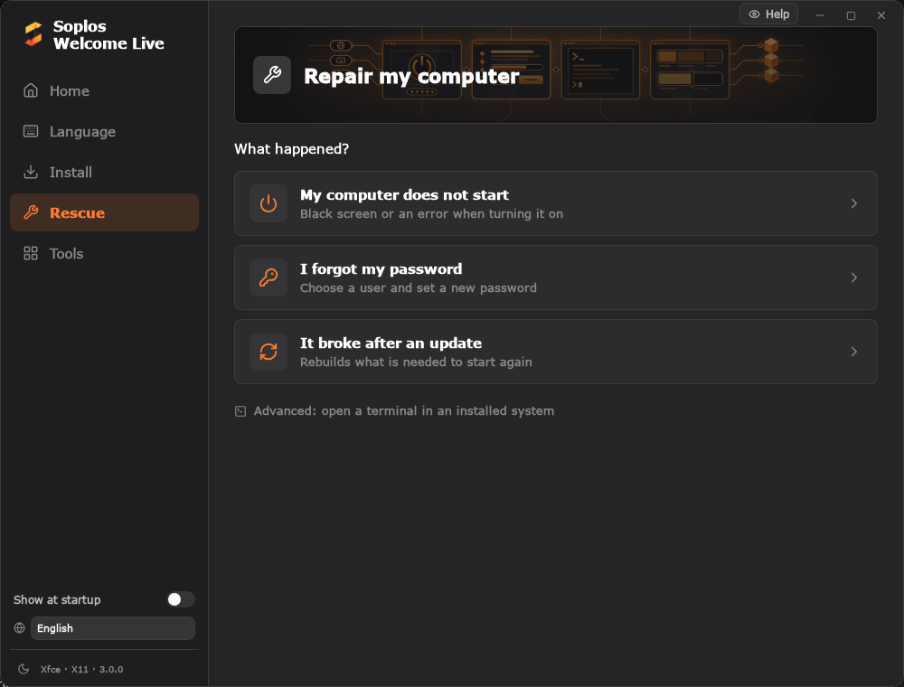
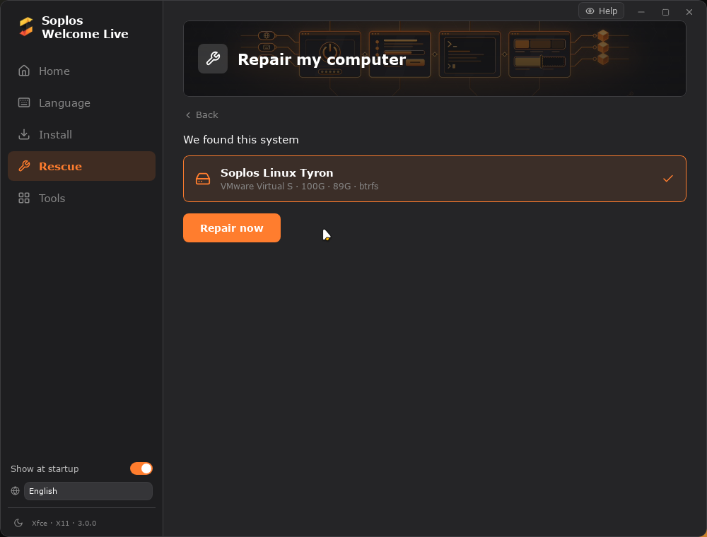
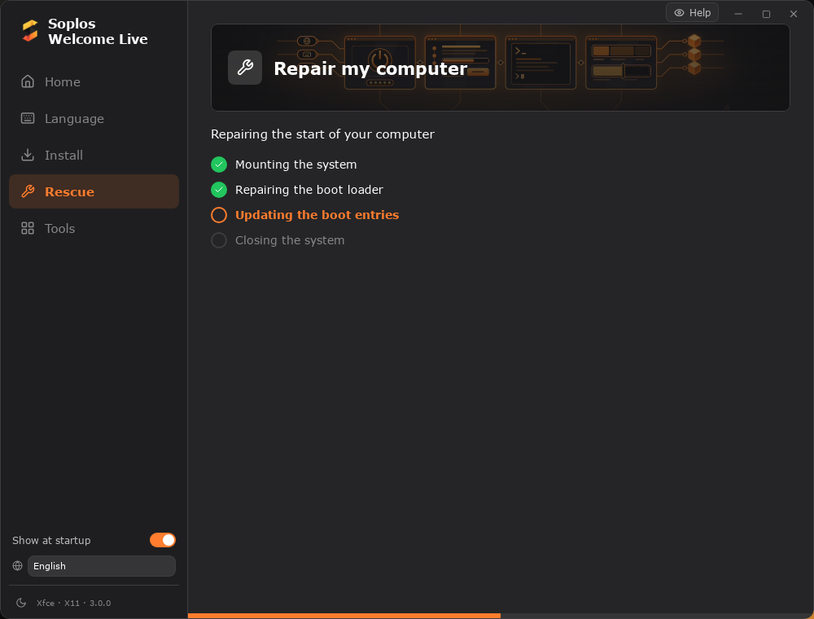
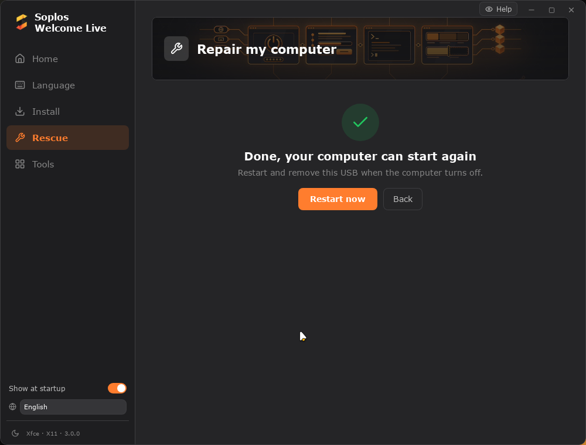
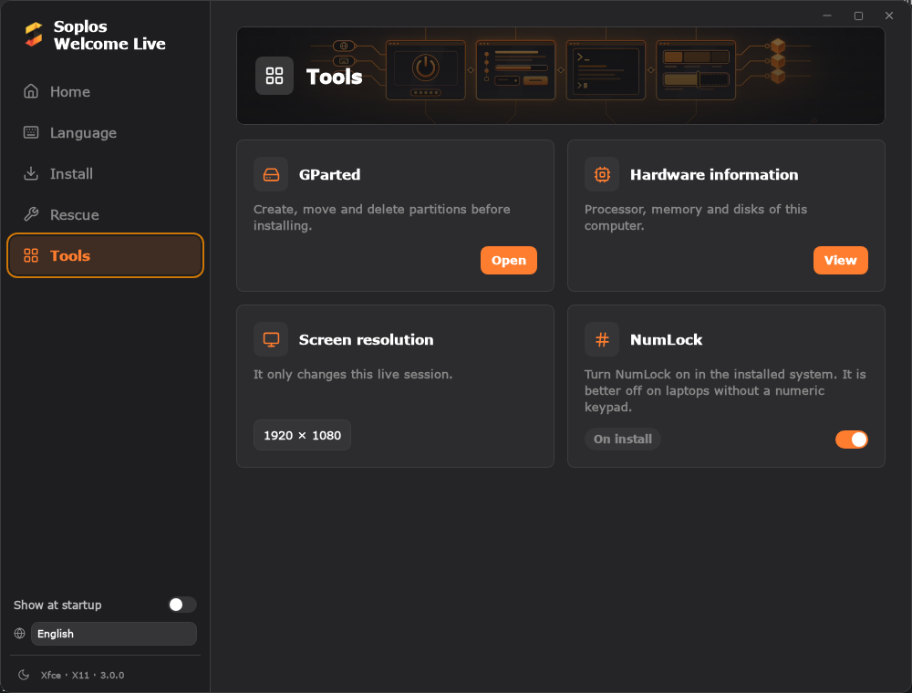

# Soplos Welcome Live 3.0


The welcome screen of the Soplos Linux live session.

Install Soplos, repair a system you already have without knowing any command, partition disks and change the language and keyboard of the session. It runs on Xfce (Tyron), Plasma (Tyson) and GNOME (Boro), on X11 and Wayland.

|  Home: the edition, the hardware and the three things you can do |  Language and keyboard: the language, the region and the layout of the session |
|:---:|:---:|
|  Install: what to check before starting the installer |  Rescue: say what happened, in plain words |
|  Rescue: the installed system found by itself |  Rescue: the repair, step by step |
|  Rescue: done, and the computer can start again |  Tools: GParted, the hardware, the screen resolution and NumLock |

## Status

This is a beta of the rewrite of the 2.x program (Python 3 and GTK3). It has been tested in a live session of Soplos Linux Tyson, on Plasma and Wayland, in a virtual machine; the other desktops and real hardware are still to be tested: report anything that fails.

## Features

- **Language and keyboard**: changes the language and the keyboard layout of the system, moves the user folders to their new names and restarts the session. The keyboard follows the language but can be changed on its own, in the eight languages of the dictionaries.
- **Install**: launches the installer of the live session, Soplos Linux Installer (Calamares before 3.0). Before it starts, it shows the internet connection, the boot mode (UEFI or BIOS), the disks and whether the computer runs on battery. The installer is read from `installer.json`, so replacing it means replacing that file and not the code.
- **Rescue**: repairs an installed system in plain language: the computer does not start, a forgotten password, a failure after an update. It finds the installed systems by itself, BTRFS subvolumes included, and mounts the boot, EFI and home partitions that the system's own `/etc/fstab` names. The repair runs step by step and the technical output stays folded under "Show details". The advanced option opens a terminal inside the installed system.
- **Tools**: GParted, the hardware information, the screen resolution of the session (X11 and Plasma) and NumLock for the installed Tyron system.
- **Edition aware**: one program for the three editions. The terminal of the rescue, the restart of the session and the launcher fixes are those of each desktop.
- **Light and dark theme** that follows the desktop, and a window with no frame of the system.
- **Eight languages**: English, Spanish, German, French, Italian, Portuguese, Romanian and Russian.

## Keyboard shortcuts

| Shortcut | Action |
|---|---|
| F1 | About |
| F5 | Reload the page (not while a job is running) |
| Ctrl+I | Show or hide the notes of the page (Rescue) |
| Ctrl+Tab / Ctrl+Shift+Tab | Next or previous page |
| Ctrl+Q | Quit |

## Architecture

Version 3.0 is a rewrite of Soplos Welcome Live: a Rust backend and a Svelte 4 + Tailwind CSS frontend, rendered through the system's WebKitGTK, with the layout of Soplos Welcome 3.0 (a sidebar, a header on every page but the first and a progress bar along the bottom edge).

- **Backend** (`src-tauri/src/commands/`): `environment.rs` (edition, desktop and display protocol), `system.rs` (hardware, autostart and the internet check), `installer.rs` (the installer and NumLock), `tools.rs` (GParted, hardware and resolution), `language.rs` (the language change, step by step) and `rescue.rs` (finding, mounting and repairing the installed systems).
- **Frontend** (`src/`): the sidebar, five views (Home, Language, Install, Rescue and Tools), the dialogs shared with the other 3.0 programs and the 8-language dictionaries under `src/i18n/`.
- **Privileges**: the window never runs as the superuser. The live user runs the system commands with `sudo` without a password, as in 2.x, and GParted is opened through `pkexec`.

## Build

```bash
npm install
npm run tauri dev       # development
./package.sh            # builds the .deb and copies it to Descargas and MEGA
```

## Project layout

```
src/                     Svelte interface (App, sidebar, views, i18n)
src-tauri/src/commands/  Rust commands
src-tauri/resources/     desktop file, metainfo, installer.json, manual page and screenshots
docs/                    source of the manual page
```

## License

GPL-3.0-or-later. Copyright 2026 Sergi Perich.

## Support

- Website: https://soplos.org
- Issues: https://github.com/SoplosLinux/soplos-welcome-live-3.0/issues
